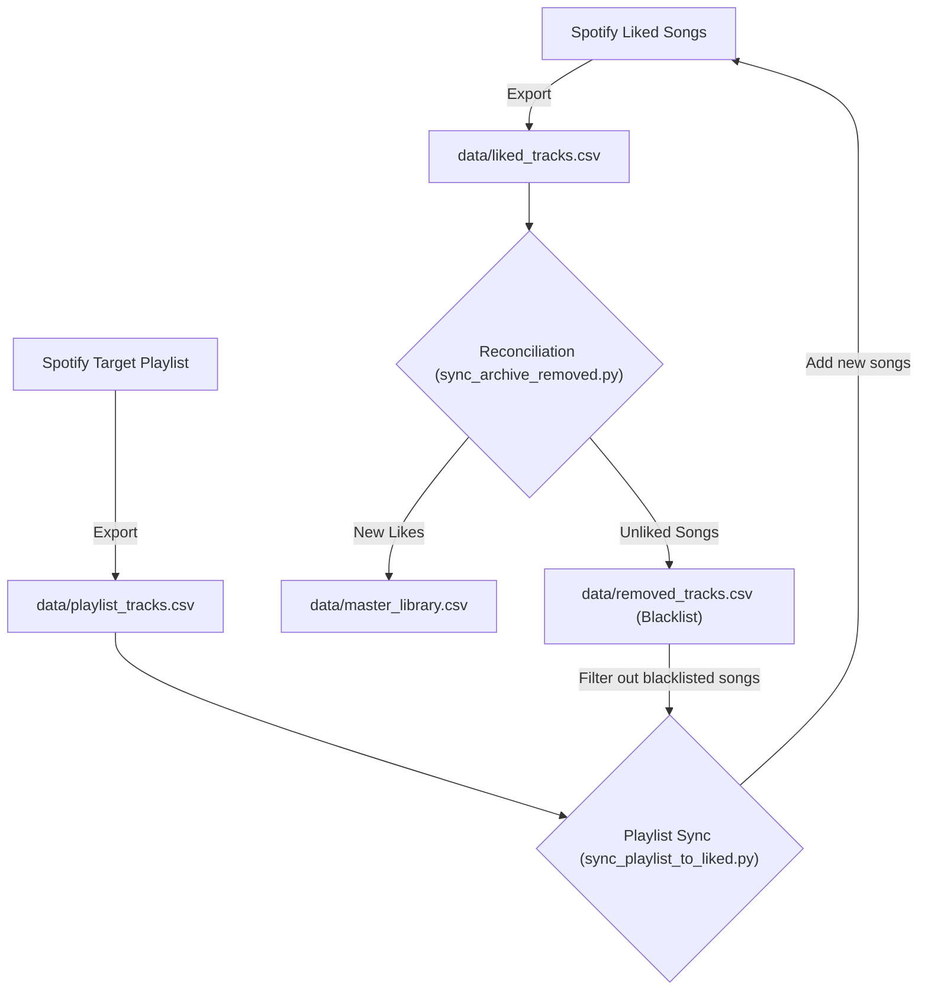

# Spotify Playlist & Library Synchronizer (`spotipy-playlist-sync`)


A modular Python automation tool to back up, synchronize, and archive your **Spotify Liked Songs** and custom playlists. 

Includes automatic metadata extraction (Track ID, Track Name, Album, Artists), bi-directional synchronization, duplicate prevention, and persistent tracking of removed songs through local CSV archives.

---

## ⚡ Key Features

- 📥 **Export to CSV**: Backup your complete Liked Songs collection or any playlist to local CSV files with full track, album, and artist metadata.
- 🔄 **Liked Songs to Playlist Sync**: Replicate your Liked Songs library into a dedicated playlist using batched API requests (100 tracks per batch) and automatic duplicate avoidance.
- 🗄️ **Master Archive & Removal Tracking**: Maintain a permanent master archive (`data/master_library.csv`) and log unliked/deleted tracks into `data/removed_tracks.csv`.
- ➕ **Playlist to Liked Songs Sync**: Automatically like tracks found in a playlist, while respecting your removal blacklist to prevent re-adding intentionally unliked songs.
- 🖥️ **Interactive CLI & Automation Flags**: Launch an interactive terminal menu or integrate individual scripts into scheduled cron jobs / task schedulers.
- 🔒 **Secure Credential Management**: Clean OAuth2 authentication using `python-dotenv` without hardcoding tokens or API secrets.

---

## 📁 Repository Structure

```
spotipy-playlist-sync/
├── data/
│   ├── liked_tracks.csv          # Snapshot of current Liked Songs
│   ├── master_library.csv        # Permanent archive of all historical liked songs
│   ├── playlist_tracks.csv       # Snapshot of targeted playlist tracks
│   └── removed_tracks.csv        # Blacklist of intentionally unliked/removed songs
├── spotify_client.py             # Authenticated Spotipy client and OAuth manager
├── list_liked_tracks.py          # Exports user library to data/liked_tracks.csv
├── list_playlist_tracks.py       # Exports playlist tracks to data/playlist_tracks.csv
├── sync_liked_to_playlist.py     # Uploads liked tracks to a destination playlist
├── sync_archive_removed.py       # Reconciles liked tracks against master & removed lists
├── sync_playlist_to_liked.py     # Adds new playlist tracks to likes (respects blacklist)
├── main.py                       # Unified interactive CLI and argument runner
├── .env.example                  # Template for Spotify API credentials
├── requirements.txt              # Python library dependencies
├── .gitignore                    # Excludes .env, OAuth cache, and runtime artifacts
└── README.md                     # Project documentation
```

---

## 🚀 Getting Started

### 1. Prerequisites
- **Python 3.8+** installed on your system.
- A **Spotify** account.

### 2. Create a Spotify Developer Application
1. Go to the [Spotify Developer Dashboard](https://developer.spotify.com/dashboard) and log in.
2. Click **Create an App**.
3. Fill in the App Name and Description.
4. Set the **Redirect URI** to:
   ```text
   http://localhost:1234/
   ```
5. Click **Save**, then navigate to your app settings to view your **Client ID** and **Client Secret**.

### 3. Installation
Clone the repository and install the required dependencies:

```bash
cd spotipy-playlist-sync

# Create a virtual environment (optional but recommended)
python -m venv .venv

# Activate virtual environment
# Windows:
.venv\Scripts\activate
# Linux/macOS:
source .venv/bin/activate

# Install dependencies
pip install -r requirements.txt
```

### 4. Configure Environment Variables
Copy the `.env.example` file to `.env`:

```bash
cp .env.example .env
```

Open `.env` in a text editor and add your Spotify credentials:

```ini
SPOTIPY_CLIENT_ID="your_client_id_here"
SPOTIPY_CLIENT_SECRET="your_client_secret_here"
SPOTIPY_REDIRECT_URI="http://localhost:1234/"
SPOTIPY_PLAYLIST_ID="your_destination_playlist_id_here"
```

> 💡 **Where to find Playlist ID?**
> In the Spotify desktop or mobile app, right-click any playlist &rarr; **Share** &rarr; **Copy link to playlist**.
> The link looks like `https://open.spotify.com/playlist/1AqH1rJqh1fWJdC5ZqCOec?si=03f2c13999134aa8`. The ID is `1AqH1rJqh1fWJdC5ZqCOec`.

---

## 💻 Usage

### Interactive CLI Menu
Run the main script without arguments to open the interactive menu:

```bash
python main.py
```

```text
==================================================
    SPOTIFY PLAYLIST & LIBRARY SYNCHRONIZER
==================================================
1. Export Liked Tracks to CSV (data/liked_tracks.csv)
2. Export Playlist Tracks to CSV (data/playlist_tracks.csv)
3. Sync Liked Tracks into Destination Playlist
4. Sync Master Archive & Track Removals
5. Sync Playlist Tracks into Liked Songs (respecting removals)
6. Run Full Workflow (Export -> Archive -> Sync)
0. Exit
==================================================
```

### Command-Line Automation Flags
You can also run specific actions directly via CLI arguments:

```bash
# Export Liked Songs to CSV
python main.py --export-liked

# Export a specific playlist by ID
python main.py --export-playlist 1AqH1rJqh1fWJdC5ZqCOec

# Sync Liked Songs into destination playlist
python main.py --sync-to-playlist

# Run Master Library reconciliation (log removed songs)
python main.py --sync-archive

# Add playlist tracks to Liked Songs (ignoring removed songs)
python main.py --playlist-to-liked

# Run full end-to-end sync workflow
python main.py --all
```

---

## 🔄 Archiving & Blacklist Workflow



1. **`master_library.csv`**: Contains every track you have ever liked.
2. **`removed_tracks.csv`**: When you unlike a track, the next sync moves it from `master_library.csv` to `removed_tracks.csv`.
3. When pulling tracks from collaborative or discover playlists back into your Liked Songs, `removed_tracks.csv` acts as a blacklist to ensure you never accidentally re-like songs you previously removed.

---